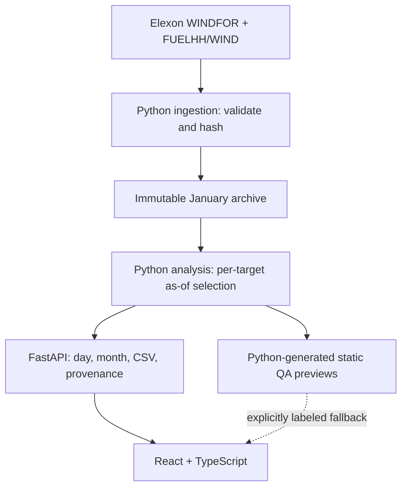

# Technical review

WindProcure is a narrow historical decision-support pilot, built around a deterministic point-in-time data contract rather than a forecasting model.

## Review route

1. `backend/analysis.py`: read `base_day`, `latest`, `metrics` and `historical_risk` first.
2. `tests/test_analysis.py`: review cutoff equality, future revision exclusion, zero handling and future-actual leakage tests.
3. `backend/ingest.py`: inspect the upstream query parameters, half-open filtering, retry policy, conflict validation and provenance.
4. `backend/app.py`: inspect input constraints and static serving order.
5. `src/data.ts`: verify that the API is authoritative and the static mode is labeled.
6. `src/App.tsx` and `src/components/Charts.tsx`: trace controls to the analytical contract.

## Components and boundaries

| Layer | Responsibilities | Deliberately excluded |
|---|---|---|
| Ingestion | Fetch 64 daily responses, filter WIND, validate numeric values, deduplicate identical keys, retain hashes and publish timestamps | A scheduled production feed, external forecasts, silent partial results |
| Repository | Group revisions by exact target timestamp and sort by publication | Network calls or mutable persistence in the request path |
| Analysis | Binary-search latest eligible version, create a 48-period delivery grid, compute exact-match metrics and lagged risk | Interpolation, client demand, price optimization, national-to-client allocation |
| API | Validate date/time scope, expose JSON and CSV, publish OpenAPI | Trading execution, authentication or user data storage |
| UI | Present cutoff selection, metrics, publication eligibility, coverage, exports and methodology | Reimplementing statistical calculations in JavaScript |

The fixed archive is small (about 1.9 MB as JSON, 114 KB as gzip). Introducing a database, background scheduler or pandas dependency would add operational cost without improving this bounded pilot. Revision indexes are built once per process. Day and month results are cached in memory with bounded LRU caches. The API performs no upstream request on page load.

## Point-in-time selection

Each target's list is sorted by publication timestamp. `bisect_right` returns the latest version at or before the cutoff. Selection is per target, so a target missing from a newer issue can retain an older eligible value. All timestamps in the ingested source use the same UTC ISO representation; January local decision dates are GMT.

An exact join retains a row for each of 48 settlement starts. `forecastMW=null` means no source forecast at that timestamp, not zero production. Actuals are kept separately with their own publication timestamps. The retrospective metrics select the latest archived actual; decision-time risk selects the latest actual published by the historical current cutoff.

## Decision-time risk

For decision D, earlier decisions D−15 through D−2 provide at most 14 completed delivery days. A previous decision's delivery must end by the current cutoff. Historical forecasts use the same chosen auction cutoff on their original decision date; historical actuals are filtered to publication <= the current decision's cutoff. P90 uses type-7 interpolated empirical order statistics and is clamped to zero for a nonnegative shortfall scenario. At least 48 matched points are required for an allowance. No pre-January decision history is silently added.

This is intentionally simple and auditable. Residuals can be serially correlated and change with wind regime. The scenario is not a calibrated probability statement. Production work should first reconcile dataset coverage, then consider out-of-sample evaluation, regime conditioning and explicit calibration with a larger authorized history.

## HTTP contract

| Endpoint | Result |
|---|---|
| `/api/health` | Dataset readiness and archive hash; 503 when missing |
| `/api/meta` | Source requests, hashes, fetch times, warnings and scope |
| `/api/day` | 48 rows, frozen forecast, latest publication, retrospective metrics, lagged risk and daily revision history |
| `/api/month` | 31 daily summaries and pooled metrics over the same exact native targets |
| `/api/export.csv` | The selected decision's 48 rows with both publication timestamps and explicit missing cells |
| `/docs` | Generated interactive FastAPI documentation |

Date inputs are parsed as dates and checked against January 2026. Cutoff inputs must match `HH:MM` with hour 00–23 and minute 00–59. Unknown/invalid values fail with 422. FastAPI serializes JSON without fabricated default values. The frontend aborts stale requests when controls change and distinguishes API delivery from the static preview.

## Deployment and development

The Vercel application exports `app` at the supported root entrypoint and builds the React bundle with Vite. The production FastAPI app registers API routes before mounting `dist/`, allowing Vercel to promote static files to its CDN while Python handles API calls. The compressed immutable archive is included in the function bundle. The data do not need a serverless writable filesystem.

Docker uses a Node build stage followed by a Python 3.12 runtime. It runs as a dedicated non-root user, honors `PORT`, exposes a health check and uses read-only Compose storage. Local full development starts both Python and Vite from one parent process and cleans up children on termination.

## Verification and practical limits

- 15 backend tests passed locally, including three parametrized full-month coverage checks.
- TypeScript and Vite production build passed.
- Public deployment root and Python endpoints were checked with anonymous HTTP requests and a fresh cloud-browser tab; this is recorded as anonymous access verification, not falsely described as a literal private-window session.
- Browser checks cover cutoff changes, multiple views, publication eligibility, filtering, an empty state and export.
- Docker is unavailable in this execution environment. Its build and smoke test are included in GitHub Actions but are not claimed to have run here.
- No authentication is needed for this public-data pilot. There are no order-placement endpoints or secrets. A production utility deployment would need its own access control, monitoring, freshness SLA and portfolio boundary.
- No live update button is claimed: reloading reads the same verified historical archive. Re-fetching the archive is an explicit offline command, followed by regeneration and redeployment.

## Design and accessibility

The provided Linear tokens define near-black surfaces, compact spacing, thin borders, Inter type and one lime primary action. Lucide provides SVG icons. A single attributed wind photograph appears in the methodology view. Controls have accessible names, dialogs trap focus and support Escape, charts support keyboard inspection, missing values are textual, and the layout has responsive breakpoints plus reduced-motion support.

The UI avoids claiming money saved, calibrated confidence, a live forecast, or a client-specific procurement quantity. Those would require evidence outside the permitted source data.
